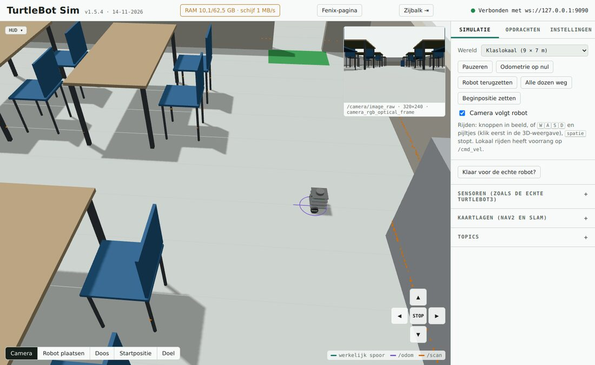
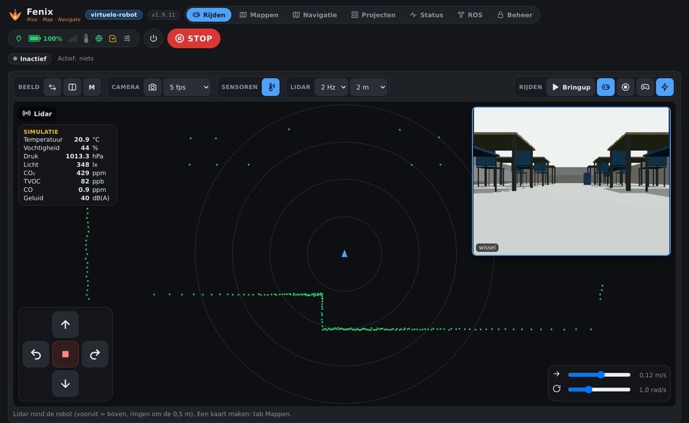

# Turtlebot Vis

Visualisatie-client (rviz2/rqt) voor op de studenten-laptop, om een
turtlebot van op afstand te bekijken/besturen. Zonder robot: de
HTML-simulator en een virtuele robot met de Fenix-pagina (zie onder).

Versie: `VERSION` (wijzigingen in `CHANGELOG.md`); `./start.sh` en `check`
tonen de versie van de scripts, de simulator en de virtuele robot. Image en
virtuele robot draaien **ROS 2 Jazzy**, zoals de robots.

| HTML-simulator (`./start.sh --htmlsim`) | Fenix-pagina van de virtuele robot (`./start.sh --fenix`) |
|---|---|
|  |  |

## Op de laptop (Ubuntu of WSL op Windows)

De container praat via **Zenoh** met de robot: een rechtstreekse
TCP-verbinding naar de Zenoh-router van de robot (`10.0.<nr>.10:7447`),
zonder de multicast-discovery van DDS - lichter op de wifi en het werkt ook
door WSL2 heen.

### Vereisten

- Docker Desktop met WSL2-integratie ingeschakeld, of Docker rechtstreeks
  in WSL2 geïnstalleerd.
- WSLg (komt standaard mee met recente Windows 11/WSL2) voor
  GUI-doorsturing van rviz2/rqt.

### Setup

```bash
git clone https://github.com/JeremyLebon/turtlebot_vis.git
cd turtlebot_vis
```

### Starten

De image staat op Docker Hub (`nobel86/turtlebot-rpi5-vis:jazzy`): eerst
pullen, **met internet** (ca. 5 GB):

```bash
docker compose pull
```

Daarna, met de laptop op de wifi van de robot (`TB-AP-<nr>`):

```bash
./start.sh
```

Dat start de container op de achtergrond, voert **`check`** uit (robot
gevonden, Zenoh-router bereikbaar, aantal topics, komt er echt data binnen,
zelfde ROS-versie als de robot, Lichtblick, bridge, display voor rviz2,
`ros2_ws`) en opent een shell in de container. `exit` verlaat de shell, de
container blijft draaien. Opties: `./start.sh --no-shell` (enkel starten en
check), `./start.sh --pull` (eerst de nieuwste scripts met `git pull` en de
nieuwste image ophalen; is `start.sh` zelf veranderd, dan start de nieuwe
versie meteen), `./start.sh --help` (alle opties). Onder WSL begrenst
`start.sh` ook het geheugen van WSL (`wsl_check.sh`).

Bezet een ander programma poort 8080? Zet `VIS_PORT=8081` in `.env` (of
`VIS_PORT=8081 ./start.sh`) en surf naar <http://127.0.0.1:8081>.

Nog een terminal in de container: **`./connect.sh`** (start de container
eerst als hij niet draait). Eén commando: `./connect.sh ros2 topic list`.

Met de hand kan ook: `docker compose up -d` en `docker exec -it turtlebot-vis
bash` - de eerste shell doet de check dan vanzelf. Opnieuw controleren:
`check` in de container.

**Welke robot** zoekt de container zelf (`docker/robot_select.sh`): de
access points zijn van elkaar afgeschermd, dus vanaf `TB-AP-<nr>` antwoordt
alleen robot `<nr>` op `10.0.<nr>.10:7447`. Die keuze (`ROS_DOMAIN_ID=<nr>`,
Zenoh-router `10.0.<nr>.10`) komt in `/tmp/robot.env` en elke shell neemt ze
over; bij het openen staat er bv. `TurtleBot 9 (ROS_DOMAIN_ID=9, ...)`.

- Andere wifi gekozen? De container merkt dat de robot weg is en zoekt
  opnieuw; open shells passen zich aan bij de volgende prompt (draaiende
  programma's zoals rviz2 opnieuw starten).
- In de container: `robot` = opnieuw zoeken, `robot 5` = vast robot 5.
- Meer dan één robot bereikbaar (bv. docent op een gerouteerd netwerk): kies
  met `robot <nr>` of zet `ROBOT_NR=<nr>` in `.env`.

In de container:

```bash
ros2 topic list          # zou de topics van de robot moeten tonen
rviz2                    # of: ros2 launch turtlebot3_navigation2 navigation2.launch.py
```

### HTML-simulator (thuis, huiswerk)

```bash
./start.sh --htmlsim
```

Start in de container een eigen Zenoh-router en rosbridge; surf naar
<http://127.0.0.1:8080/sim/>. De **TB3 Lite Sim 3D** (TurtleBot3 in de browser,
met de automatische tests van de huiswerkopdrachten) verbindt vanzelf. Je
nodes draai je in de container (`./connect.sh`), zoals op de robot. Geen
internet nodig. Terug naar de echte robot: `robot` in de container. Gazebo in
de container: `./start.sh --sim`. Broncode en tests van de simulator:
`htmlsim/` (zie `htmlsim/README.md`).

**Project sessie 4** (meetronde) in de simulator: wereld **Klaslokaal**
(9 x 7 m), taak *Project: meetronde* onder Opdrachten, met P1-P3 en de
bronnen (gaslek, warmte) per studentnummer. Gesimuleerde sensoren
(temperatuur, vochtigheid, druk, licht, CO2, TVOC, CO, geluid) en camera
zoals op de echte robot, aan/uit onder *Sensoren*. pandas, matplotlib,
seaborn en reportlab (analyse en PDF) zitten in de image.

### Virtuele robot en Fenix-pagina (back-up voor de echte robot)

`./start.sh --fenix` (of `fenix start` in de container, bij `robot htmlsim`)
start naast de simulator ook de software van de echte TurtleBot: de
Fenix-pagina op <http://127.0.0.1:8090> (knop **Fenix-pagina** in de
simulator) met Rijden, Mappen (SLAM met Cartographer, kaart opslaan,
zones), Navigatie (Nav2, planners, routes), twist_mux en cmd_vel_guard.
Zelfde knoppen en paden als op de robot; de simulator speelt de hardware en
rijdt op `/cmd_vel_out`, zoals de motoren. Kaarten en zones in
`ros2_ws/virtuele_robot/`. In rust ~0,4 GB, tijdens Navigatie ~1 GB.
Niet automatisch bij `--htmlsim` (huiswerk): stoppen met `fenix stop`.

De robotbestanden komen uit turtlebot_docker: `tools/sync_virtual_robot.sh`,
daarna de image opnieuw bouwen.

### Lichtblick (visualisatie in de browser)

De container start ook **Lichtblick** (open-source web-versie van Foxglove
Studio) en **foxglove_bridge**: surf vanuit Windows naar
<http://127.0.0.1:8080>. De pagina verbindt vanzelf met de bridge
(`ws://127.0.0.1:8765`) en opent een layout met 3D (kaart, scan, robot, pad,
doel zetten), camera en teleop (`/cmd_vel_web`). Handig als het rviz2-venster
onder WSLg niet verschijnt. De bridge haalt de topics via Zenoh, net als
rviz2: geen extra belasting op de robot. Logs: `/tmp/vis_services/` in de
container. "Connection failed" in Lichtblick: kijk in
`/tmp/vis_services/foxglove_bridge.log` - wacht de bridge nog op de robot,
dan is de robot niet bereikbaar (verkeerde wifi, robot uit, verkeerd vast
nummer).

### Problemen oplossen

Eerst **`check`** in de container (of `./start.sh`, dat doet hem ook): per
onderdeel ✔ of !, met eronder wat je moet doen. De meest voorkomende:

**Verbinding met de robot**

- **Robot: nog geen robot gekozen** of **Zenoh-router `10.0.<nr>.10:7447`
  NIET bereikbaar**: laptop op de wifi `TB-AP-<nr>` van jouw robot? Robot aan
  (melodie gehoord)? Dan `robot` in de container (opnieuw zoeken), of vast:
  `robot <nr>`.
- **Topics: geen enkel topic zichtbaar**: zelfde vragen; `ROS_DOMAIN_ID` moet
  exact het robotnummer zijn (de automatische keuze zorgt daarvoor, zie de
  regel bij het openen van de shell: `TurtleBot <nr>`).
- **Data: topics zichtbaar, maar er komt GEEN data binnen** of
  **ROS-versie: robot draait humble/jazzy, deze laptop ...**: robot en laptop
  draaien een andere ROS-versie. De versie van de robot staat op de
  Fenix-pagina; v1.x = Jazzy = deze image (`:jazzy`).
- **Bringup staat uit**: geen `/scan`, `/odom` of motoren. Start **Bringup** op
  de Fenix-pagina (`http://10.0.<nr>.10:8080`, tab Rijden).
- **Dubbel** (bridges meer dan één keer): restjes van een vorige modus
  (simulator, andere robot); opruimen met `robot <nr>`.
- Geen camerabeeld of alles hapert: neem in Lichtblick of rviz2 altijd
  `/camera/image_raw/compressed`, nooit `/camera/image_raw` (ongeveer
  110 Mbit/s: genoeg om de wifi van de robot te laten vastlopen).

**Laptop en Docker**

- **Image beschadigd** (of twist_mux/SLAM faalt bij één student terwijl het
  bij anderen werkt): in WSL `docker compose down` en
  `docker image rm nobel86/turtlebot-rpi5-vis:jazzy`, dan `./start.sh --pull`
  op een goed netwerk. Een gewone `--pull` herstelt het niet.
- **Geheugen** (WSL ... GB vrij, programma afgesloten wegens
  geheugentekort): sluit andere programma's; `diagnose` in de container toont
  live het geheugen per onderdeel. `start.sh` begrenst WSL zelf
  (`wsl_check.sh`); na een wijziging in `.wslconfig` eerst `wsl --shutdown`
  in PowerShell.
- `docker compose pull` op de robotwifi lukt niet: die heeft geen internet.
  Pull op eduroam of thuis (ongeveer 5 GB).
- `git pull` stopt met *Your local changes ... would be overwritten* en
  noemt `.env`: oude robotinstelling, niet meer nodig. `git checkout .env`
  en opnieuw `git pull` (andere bestanden: `git stash`; je code in `ros2_ws`
  blijft staan).
- Poort 8080 bezet (Lichtblick of simulator laadt niet): `VIS_PORT=8081` in
  `.env`, surf naar <http://127.0.0.1:8081>.
- Docker Desktop: `network_mode: host` moet aanstaan (Instellingen ->
  Resources -> Network -> *Enable host networking*). Anders lijkt de
  container te starten, maar bereikt hij de robot niet.

**Vensters en browser**

- **Display: geen DISPLAY** of rviz2/rqt opent geen venster: gebruik
  Lichtblick (<http://127.0.0.1:8080>), of probeer
  `LIBGL_ALWAYS_SOFTWARE=1 rviz2`. Werkt WSLg zelf? Test buiten Docker met een
  GUI-app in WSL (bv. `xeyes`).
- Lichtblick zegt *Connection failed*: kijk in
  `/tmp/vis_services/foxglove_bridge.log`. Wacht de bridge op de robot, dan is
  de robot niet bereikbaar (zie hierboven).
- **Simulator**: verbindt niet (`ws://127.0.0.1:9090`): `robot htmlsim` in
  de container start rosbridge opnieuw. **Fenix-pagina (virtuele robot)
  antwoordt niet**: `fenix stop`, `fenix start`; logs in
  `/tmp/vis_services/vr_*.log`.

## Camera kalibreren (intrinsiek)

Nodig voor alles wat afstanden uit het camerabeeld haalt (AprilTag, lidar op
het camerabeeld). Eenmalig per robot en per resolutie:

1. Print een dambord (bv. 9x7 vakjes = 8x6 binnenhoeken, vakjes van 25 mm -
   meet na!) en kleef het op iets vlaks.
2. Laptop verbonden met de robot, `turtlebot-vis` draait, en X11 werkt
   (de kalibratie opent een venster).
3. `./calibrate_camera.sh 8x6 0.025`
4. Beweeg het dambord tot X, Y, Size en Skew groen zijn, dan CALIBRATE en
   COMMIT. De robot bewaart de kalibratie zelf; de Systeem-pagina toont
   "Intrinsiek gekalibreerd".
